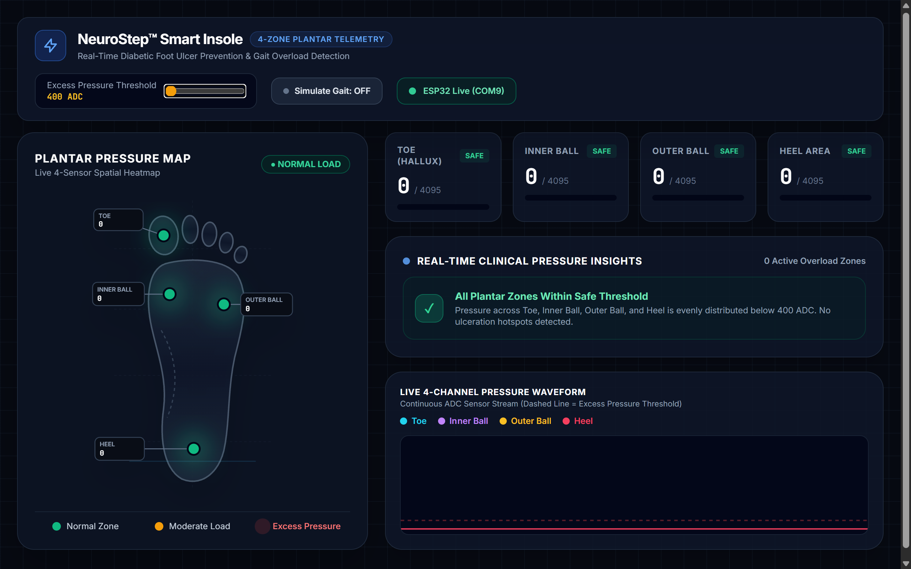
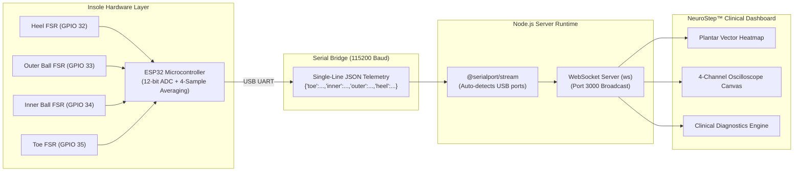

<div align="center">

# 🩺 NeuroStep™ — Smart Diabetic Insole System
### *Next-Generation Real-Time Plantar Pressure Monitoring & Diabetic Foot Ulcer (DFU) Prevention*

[](https://opensource.org/licenses/MIT)
[](https://www.espressif.com/)
[](https://nodejs.org/)
[-010101?style=for-the-badge&logo=socketdotio&logoColor=white)](https://developer.mozilla.org/en-US/docs/Web/API/WebSockets_API)
[](https://tailwindcss.com/)
[](https://github.com/mahitmass/dtu2)

<br/>

<!-- HERO DASHBOARD PREVIEW -->
<p align="center">
  
</p>

*Figure 1: NeuroStep™ live clinical telemetry interface featuring 4-zone anatomical plantar heatmaps, real-time ADC wave oscilloscope, and gait diagnosis analytics.*

</div>

---

## 📌 Table of Contents
- [🎯 Mission & Clinical Background](#-mission--clinical-background)
- [✨ Key Features](#-key-features)
- [🛠️ System Architecture & Data Flow](#️-system-architecture--data-flow)
- [💻 Tech Stack](#-tech-stack)
- [🔌 Hardware Schematics & Sensor Pinout](#-hardware-schematics--sensor-pinout)
- [🚀 Quick Start & Installation](#-quick-start--installation)
  - [Prerequisites](#prerequisites)
  - [Hardware Setup & ESP32 Flashing](#hardware-setup--esp32-flashing)
  - [Windows Terminal Setup](#-windows-powershell--cmd)
  - [macOS Terminal Setup](#-macos-zsh--bash)
- [🧪 Simulation / Demo Mode](#-simulation--demo-mode)
- [🏥 Clinical & Real-World Applications](#-clinical--real-world-applications)
- [🔮 Future Enhancements Roadmap](#-future-enhancements-roadmap)
- [❓ Troubleshooting & FAQs](#-troubleshooting--faqs)
- [👥 Authors & Acknowledgments](#-authors--acknowledgments)
- [📄 License](#-license)

---

## 🎯 Mission & Clinical Background

Diabetic Peripheral Neuropathy (DPN) affects over **50% of individuals with chronic diabetes**, leading to a progressive loss of protective sensation (LOPS) in the lower extremities. Because patients can no longer feel friction, shear, or localized hyper-pressure, repetitive mechanical stress during everyday walking causes subcutaneous tissue breakdown, micro-tears, and eventually **Diabetic Foot Ulcers (DFUs)**.

> **Critical Metric:** Over **80% of diabetes-related lower extremity amputations** originate from an undetected foot ulcer. A single ulcer costs healthcare providers an estimated \$13,000–\$45,000 to manage.

### The NeuroStep™ Solution
**NeuroStep™** bridges the bio-mechanical sensory gap. By embedding thin-profile Force-Sensitive Resistors (FSRs) directly underneath key high-risk ulceration zones and streaming high-frequency biometric data to an interactive diagnostic workstation, the system:
1. **Detects focal pressure hotspots** before micro-vascular breakdown occurs.
2. **Warns patients and clinicians** instantaneously through visual pulse alerts and waveform anomalies.
3. **Offers accessible, non-invasive gait telemetry** for clinical research and home rehabilitation.

---

## ✨ Key Features

- **🦶 4-Zone Anatomical Plantar Heatmap:** An interactive SVG vector foot model with Gaussian blur radial diffusion that mimics physical thermal dissipation across the Hallux (Big Toe), 1st Metatarsal (Inner Ball), 5th Metatarsal (Outer Ball), and Calcaneus (Heel).
- **⚡ Sub-Millisecond WebSocket Telemetry:** Real-time data pipeline running at 20 updates/second (20 FPS) over full-duplex WebSockets with zero frame stutter or perceptual latency.
- **🔌 Zero-Configuration Auto Serial Discovery:** Plug-and-play USB hardware detection for both Windows COM ports (`COM3`, `COM4`, etc.) and macOS serial nodes (`/dev/cu.usbserial*`, `/dev/cu.wchusbserial*`). No manual configuration required.
- **📈 4-Channel Live Oscilloscope:** Multi-trace HTML5 Canvas rendering continuous pressure wave cycles, overlaid with an excess-pressure threshold marker.
- **🎛️ Live Sensitivity Calibration:** Real-time threshold slider (400–3800 ADC) allows immediate adjustment for varying patient body weights, footwear stiffness, and sensor sensitivities.
- **🚨 Dynamic Clinical Insights Engine:** Intelligent diagnostic engine that monitors load distribution, detects off-balance pronation/supination, and flags high-risk continuous contact zones.
- **🕹️ Built-in Gait Cycle Simulator:** One-click offline simulation mode with heel-strike, mid-stance, and toe-off biomechanical sequencing for demonstrations without physical hardware.

---

## 🛠️ System Architecture & Data Flow



---

## 💻 Tech Stack

### Embedded Systems
- **Platform:** ESP32-WROOM-32 / NodeMCU ESP32 (30-pin & 38-pin compatible)
- **Framework:** Arduino Core C++
- **ADC Configuration:** 12-bit Resolution (`0` to `4095` discrete pressure increments)
- **Signal Conditioning:** Multi-sample moving average filter (4 samples per frame)
- **Sampling Rate:** 20 Hz transmission cycle (50 ms loop)

### Backend & Gateway
- **Runtime:** Node.js (v18.0.0+)
- **Server Framework:** Express.js 4.x
- **Hardware Interface:** `serialport` v12 + `@serialport/parser-readline`
- **Networking:** `ws` (RFC 6455 WebSocket protocol)

### Frontend & Telemetry Dashboard
- **Markup & Styling:** Semantic HTML5 + Tailwind CSS (Cyber-Medical Dark Theme)
- **Vector Graphics:** Custom SVG anatomical foot template with dynamic CSS radial filters
- **Waveform Rendering:** HTML5 Canvas API (High-performance hardware-accelerated 2D context)
- **Typography:** `Inter` & `JetBrains Mono`

---

## 🔌 Hardware Schematics & Sensor Pinout

Connect four Force-Sensitive Resistors (FSRs) using standard voltage divider circuits with **10 kΩ pull-down resistors**:

```
+3.3V (ESP32)
   │
 [ FSR Sensor ]
   │
   ├───────────────> ESP32 ADC1 GPIO Pin (Analog In)
   │
 [ 10kΩ Resistor ]
   │
  GND
```

### Pin Assignment Table

| Anatomical Sensor Zone | Medical Significance | ESP32 ADC Pin | Pin Type | Voltage Range |
|---|---|---|---|---|
| **Big Toe (Hallux)** | High-stress push-off ulcer zone | **GPIO 35** | `ADC1_CH7` (Input only) | 0 – 3.3V |
| **Inner Ball (1st Metatarsal)** | Highest DFU incidence point | **GPIO 34** | `ADC1_CH6` (Input only) | 0 – 3.3V |
| **Outer Ball (5th Metatarsal)** | Lateral balance & supination strain | **GPIO 33** | `ADC1_CH5` (Analog / Touch) | 0 – 3.3V |
| **Heel (Calcaneus)** | Initial strike impact & shock absorption | **GPIO 32** | `ADC1_CH4` (Analog / Touch) | 0 – 3.3V |

> ⚠️ **Important Note:** Only **ADC1** pins (GPIOs 32–39) are utilized. This ensures complete immunity from WiFi/Bluetooth ADC2 conflicts if wireless features are enabled in the future.

---

## 🚀 Quick Start & Installation

### Prerequisites
1. **Node.js**: Version 18.0.0 or higher ([Download Node.js](https://nodejs.org/)).
2. **Git**: Installed on your system ([Download Git](https://git-scm.com/)).
3. **Arduino IDE**: Version 2.0+ ([Download Arduino IDE](https://www.arduino.cc/en/software)) with the **ESP32 Board Package** installed.
4. **USB Drivers**: Ensure you have either the **CP210x** or **CH340** driver installed for your ESP32 board.

---

### Hardware Setup & ESP32 Flashing

1. Connect your ESP32 to your computer with a micro-USB / USB-C data cable.
2. Launch the **Arduino IDE**.
3. Go to **Tools** > **Board** > **esp32** > Select **ESP32 Dev Module**.
4. Go to **Tools** > **Port** > Select the active COM port (Windows) or `/dev/cu.usb...` (Mac).
5. Open `esp32_insole/esp32_insole.ino`.
6. Click **Upload** (Ctrl+U / Cmd+U).
7. 🔴 **CRITICAL:** Once upload completes, **close the Arduino Serial Monitor and Serial Plotter**. The Node.js server needs exclusive ownership of the USB serial interface.

---

### 🪟 Windows (PowerShell / CMD)

```powershell
# 1. Clone the repository
git clone https://github.com/mahitmass/dtu2.git
cd dtu2

# 2. Install all Node.js dependencies
npm install

# 3. Start the NeuroStep server
npm start
```

Open your browser and navigate to:
```
http://localhost:3000
```

> **Windows Tip:** If the ESP32 is not detected, check **Device Manager** > **Ports (COM & LPT)** to verify that your board shows up without yellow warning triangles.

---

### 🍎 macOS (Zsh / Bash)

```zsh
# 1. Clone the repository
git clone https://github.com/mahitmass/dtu2.git
cd dtu2

# 2. Check connected ESP32 USB ports (optional)
ls /dev/cu.usb* /dev/cu.wch* 2>/dev/null

# 3. Install dependencies
npm install

# 4. Start the NeuroStep server
npm start
```

Open your browser and navigate to:
```
http://localhost:3000
```

> **macOS Tip:** If macOS prompts you for permission to access USB accessories, click **Allow**. The server automatically filters out virtual Bluetooth ports and targets hardware USB-UART bridges.

---

## 🧪 Simulation / Demo Mode

No physical hardware available? No problem!

1. Start the server via `npm start`.
2. Open `http://localhost:3000` in any web browser.
3. Click the **"Simulate Gait: OFF"** button in the top navigation bar.
4. The dashboard will instantly run a high-precision synthetic gait cycle:
   - **Phase 1: Heel Strike** (Heel spikes to ~2800 ADC)
   - **Phase 2: Mid-Stance & Roll** (Inner/Outer balls engage at ~3100 ADC)
   - **Phase 3: Terminal Stance & Toe-Off** (Hallux peaks at ~3500 ADC)
   - **Phase 4: Swing Phase** (Zero pressure relaxation)

---

## 🏥 Clinical & Real-World Applications

- **Diabetic Neuropathy & Ulcer Prevention:** Continual tracking of pressure distribution prevents tissue ischemia and catastrophic diabetic ulcers.
- **Post-Operative Orthopedic Rehabilitation:** Ensures patients adhere to partial weight-bearing (PWB) protocol restrictions after foot or ankle surgery.
- **Sports Biomechanics & Foot Strike Optimization:** Real-time feedback for marathon runners and sprinters to assess forefoot vs. rearfoot landing kinematics.
- **Custom Orthotics Fitting:** Quantitative validation for podiatrists to verify that custom shoe inserts evenly redistribute plantar load.
- **Neurological & Parkinson's Gait Analysis:** Detection of gait freezing, irregular cadences, and lateral asymmetry.

---

## 🔮 Future Enhancements Roadmap

- [ ] **Bluetooth Low Energy (BLE 5.0) & ESP-NOW:** Complete cordless operation with an ultra-low-power battery shield (LiPo 3.7V + TP4056 charger).
- [ ] **High-Density Sensor Matrix (16–32 Zones):** Transitioning from 4 discrete nodes to a flexible matrix insole utilizing CD74HC4067 multiplexers.
- [ ] **Integrated 6-DOF IMU (MPU6050 / BNO055):** Combine plantar pressure with accelerometer and gyroscope telemetry for real-time pronation, supination, and foot angle analysis.
- [ ] **Edge ML / TinyML Anomaly Detection:** Deploy a micro-TensorFlow / Edge Impulse model on ESP32 to classify gait pathologies on-chip.
- [ ] **Cross-Platform Mobile Application:** Native companion app built with Flutter / React Native featuring vibration haptic feedback alerts on smartwatches.
- [ ] **Cloud Health Record Integration:** Export HIPAA and HL7/FHIR compliant telemetry reports for podiatrists and endocrinologists.

---

## ❓ Troubleshooting & FAQs

<details>
<summary><b>1. Port 3000 is already in use (Error: EADDRINUSE)</b></summary>
Another application is already using port 3000. You can change the port in `server.js` (line 7) or kill the existing process:

**Windows (PowerShell):**
```powershell
Get-Process -Id (Get-NetTCPConnection -LocalPort 3000).OwningProcess | Stop-Process -Force
```

**macOS (Terminal):**
```zsh
lsof -ti:3000 | xargs kill -9
```
</details>

<details>
<summary><b>2. Server says "Scanning USB for ESP32..." and never connects</b></summary>
- Ensure your USB cable is a <b>data cable</b> (many micro-USB cables are charge-only).
- Close the Arduino IDE Serial Monitor or Serial Plotter.
- Install the driver for your ESP32's USB-to-UART chip (Silicon Labs CP210x or WCH CH340).
</details>

<details>
<summary><b>3. ADC values remain 0 even when pressing the sensors</b></summary>
- Verify that your 10kΩ pull-down resistors are properly grounded.
- Ensure the sensors are connected to pins 32, 33, 34, and 35.
- Check that the FSR power lead is connected to 3.3V (not 5V, to prevent damaging the ESP32's ADC inputs).
</details>

---

## 👥 Authors & Acknowledgments

- **Lead By:** Dwij Bhardwaj
-  **With Team:** Harshit Kumar, Akshar Soni, Sarvendra Balraj and [Mahit Agarwal](https://github.com/mahitmass)
- **Institution / Project:** DTU Smart Healthcare & Bio-Telemetry Initiative

---

## 📄 License

This project is licensed under the **MIT License** — feel free to use, modify, and distribute this codebase for academic, research, and commercial applications.

<div align="center">
  <sub>Engineered with precision for preventive healthcare and biomechanical telemetry.</sub>
</div>

